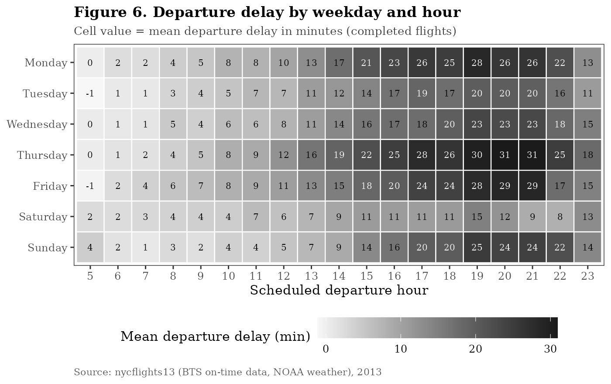

# NYC Flights 2013 – Exploratory Data Analysis in R

Week 2 task of the **Data Science with R Apprentice Internship**: an exploratory data analysis (EDA) of all 336,776 domestic flights that departed New York City's three airports (JFK, LGA, EWR) in 2013.

**Question:** What drives flight delays and cancellations out of New York, and when, where and under what conditions does punctuality break down?

## Dataset

[nycflights13](https://cran.r-project.org/package=nycflights13) – on-time records from the US Bureau of Transportation Statistics joined with NOAA hourly weather (CC0 licence). Tables used: `flights`, `weather`, `planes`, `airlines`. Copies are stored in `data/` so the project runs offline.

## Project structure

```
data/                       raw CSV tables (flights zipped)
R/01_load_and_clean.R       load, quality audit, cleaning, joins
R/02_exploratory_analysis.R summary statistics, group comparisons, anomaly detection
R/03_visualizations.R       nine ggplot2 figures
outputs/figures/            fig01-fig09 (PNG)
outputs/tables/             summary tables (CSV)
outputs/*_console.txt       console output of each script
report/                     Word report and the script that builds it
run_all.R                   runs the whole pipeline
```

## How to run

```r
install.packages(c("dplyr", "tidyr", "ggplot2", "scales"))
setwd("path/to/nyc-flights-eda")
source("run_all.R")
```

Built with R 4.3.3, dplyr 1.1.4, tidyr 1.3.1, ggplot2 3.4.4, scales 1.3.0.

## Cleaning highlights

- Missing departure times (8,255) identified as **cancelled** flights and 1,175 missing arrival delays as **diversions** – flagged, not imputed
- Impossible wind-speed reading (1,048 mph) set to NA; `wind_gust` (80% missing) and plane `speed` (99% missing) dropped
- HHMM clock times converted to minutes after midnight; calendar, on-time (BTS < 15 min) and delay-band features created
- Weather (99.5% match) and aircraft (82.8% match) joined with left joins

## Key findings

| # | Finding |
|---|---------|
| 1 | Delays are heavily right-skewed: median arrival delay −5 min, mean +6.9 min |
| 2 | Delays build through the day: 0–4 min at 5–7 am vs 20–31 min in the evening |
| 3 | Arrival delay ≈ departure delay (r = 0.91, slope 1.02, R² = 0.84) |
| 4 | June–July and December are worst; September is best (86% on time) |
| 5 | Cancellations are event-driven – over 50% cancelled on 8–9 Feb 2013 (blizzard) |
| 6 | Rain cuts the on-time rate from 77% to 51%, despite weak linear correlations |
| 7 | On-time rate ranges from 61% (Frontier) to 87% (Hawaiian) by carrier |

## Visualizations

Bar chart (missing values) · Histogram (delay distribution) · Box plot (carriers) · Multi-panel line chart (monthly trend) · Time series (daily cancellations) · Heat map (weekday × hour) · Scatter plot with regression (departure vs arrival delay) · Correlation matrix (weather) · Grouped bar chart (visibility × rain)



## Author

Prashansa Gharat
